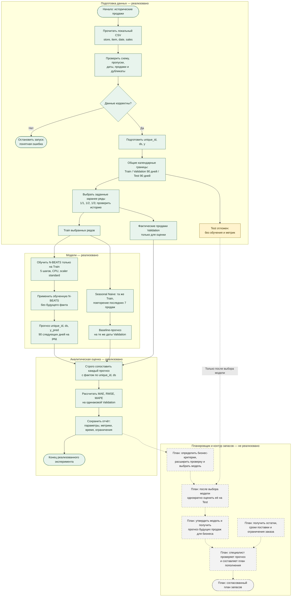

# Бизнес-процесс прогнозирования продаж и планирования запасов

Документ ДЗ №2. Основан на коде проекта и
[отчёте реального эксперимента](docs/experiments/real_sales.md).
Характеристики модели и ограничения приведены в [model_card.md](model_card.md).

## Задача и роль модели

Реализованная ML-задача — прогноз количества ежедневных продаж для пары
магазин–товар на 90 дней по историческим продажам. N-BEATS получает окно
из 180 наблюдений; обвязка требует минимум 270 непрерывных дней Train.
ML рассматривается как способ учесть обучаемые временные зависимости.
Нужность и бизнес-эффективность такого подхода пока не доказаны: в проекте
он сравнивается с простым Seasonal Naive, повторяющим последнюю неделю.

**Предполагаемая бизнес-задача** — использовать прогноз как один из входов
планирования запасов. Сам прогноз не определяет заказ: для этого дополнительно
нужны остатки, сроки поставки и ограничения закупок. Получение этих данных,
расчёт заказа и согласование планировщиком в проекте не реализованы.

## Диаграмма процесса

Использована BPMN-подобная схема в Mermaid `flowchart`: события начала/окончания,
задачи, шлюз проверки и дорожки участников. Это читаемое представление процесса,
а не исполняемый файл BPMN 2.0.

Сплошные связи в верхней части показывают реализованный ограниченный эксперимент.
Пунктирные связи и блоки с пометкой «план» показывают предполагаемое применение,
которое ещё не реализовано. Test отделён от обучения и оценки.

Ромб относится к проверке качества данных. В оценке ключей также возможны
ошибки: пропущенные/лишние строки, дубликаты и неконечные прогнозы останавливают
расчёт. Автоматического исправления данных или повторного обучения после ошибки
в текущем сценарии нет. Стрелка от отчёта к бизнес-контуру не означает, что
результат пятишагового запуска уже пригоден для закупок.

## Что уже работает и что предполагается

| Шаг | Вход → результат | Статус и подтверждение |
| --- | --- | --- |
| Получение истории | Локальный CSV с `store`, `item`, `date`, `sales` → DataFrame | Реализовано: [data.py](src/sales_forecasting/data.py). Реальная копия получена из исследовательского репозитория; интеграции с ERP/POS нет |
| Проверка и подготовка | Исходные продажи → `unique_id`, `ds`, `y` | Реализовано: [validation.py](src/sales_forecasting/validation.py), [preprocessing.py](src/sales_forecasting/preprocessing.py) |
| Разделение | Подготовленные ряды → Train, Validation, Test | Реализовано: [splitting.py](src/sales_forecasting/splitting.py); общие даты, непрерывная история, проверка длины и пересечений |
| Обучение N-BEATS | Только выбранная Train → обученный объект в памяти | Реализовано: [models/nbeats.py](src/sales_forecasting/models/nbeats.py); в реальном запуске 3 ряда и 5 шагов |
| Прогноз N-BEATS | Обученная модель → 90 следующих дат на ряд | Реализовано: `predict_nbeats`; будущий факт не требуется, ключи проверяются |
| Baseline | Та же Train → недельный наивный прогноз | Реализовано: [models/baseline.py](src/sales_forecasting/models/baseline.py) |
| Оценка | Прогнозы и факты Validation → MAE, RMSE, MAPE | Реализовано: [evaluation.py](src/sales_forecasting/evaluation.py), [metrics.py](src/sales_forecasting/metrics.py); Test исключён из оценки |
| Сохранение отчёта | Параметры, результаты, время → Markdown | Реализовано: [real_data_experiment.py](src/sales_forecasting/real_data_experiment.py), [отчёт](docs/experiments/real_sales.md) |
| Допуск и итоговая проверка | Утверждённые критерии, выбранная модель и Test → решение о применении | Предлагается; критерии и процедура допуска не определены, Test-метрики не рассчитаны |
| Планирование запасов | Будущий прогноз, остатки и поставки → согласованный план пополнения | Предполагается; нет интеграции с учётной системой, правил заказа или измеренного бизнес-эффекта |

`pipeline.py` — сквозной pipeline **baseline**. Показанные обучение N-BEATS,
сравнение методов и отчёт организует отдельный `real_data_experiment.py`.
Диаграмма не приписывает baseline pipeline обучение нейросети или закупки.

## Данные, границы и использование результата

Реальная панель содержит 913 000 строк и 500 рядов за 2013-01-01–2017-12-31.
Общие границы: Train до 2017-07-04; Validation 2017-07-05–2017-10-02;
Test 2017-10-03–2017-12-31. Сравнение N-BEATS и baseline выполнено только на
`1/1`, `1/2`, `1/3`: 4938 строк Train и 270 строк Validation для каждого метода.
Все 90 прогнозных дат каждого ряда относятся к Validation, а не к Test.

На одинаковых трёх рядах MAE N-BEATS составила 7.672950, baseline — 8.259259.
Полные MAE/RMSE/MAPE приведены в карточке и отчёте. Эти результаты не оценивают
N-BEATS на всех 500 рядах и не доказывают экономическую выгоду. Тестовый период
не использовался ни для обучения, ни для выбора модели, ни для текущих метрик.

**Предполагаемый следующий бизнес-шаг:** специалист сопоставляет будущие
прогнозы с доступными запасами и поставками и решает, что пополнять.
Здесь **ошибка = прогноз − фактические продажи** (`y_pred - y`).
Положительная ошибка означает завышение прогноза, отрицательная — занижение.
При использовании прогноза для пополнения завышение может дать излишки,
а занижение — дефицит; это влияние в проекте не измерено.
Продажи не всегда равны полному спросу при ограниченном
наличии товара. Необходимые сведения о наличии в модель не входят.

Модель выдаёт числовые точечные прогнозы, в том числе возможны дробные
и отрицательные значения. Правила округления, ограничения на заказ, страховой
запас, оценка неопределённости и контроль специалистом пока не реализованы.
MAPE исключает нулевой факт, поэтому её нужно читать вместе с MAE и RMSE.
Автоматическая отправка заказов и промышленное внедрение на схеме не заявляются
как выполненные компоненты.
