# ДЗ №3: процесс автоматического переобучения N-BEATS

**Предмет:** «Бизнес-применение машинного обучения».  
**Преподаватель:** Антон Кошелев.  
**Проект:** `Time_series_forecasting_Daria`.  
**Основание:** актуальный `main`, коммит `7dbb35f`, содержащий ДЗ №1 и №2.

## 1. Цель и статус схемы

Цель предлагаемого процесса — после появления новых продаж или ухудшения
качества подготовить кандидата N-BEATS, проверить его и безопасно заменить
утверждённую версию только при выполнении согласованных условий. Модель
прогнозирует ежедневные продажи каждой пары магазин–товар на следующие 90 дней.

Это **проект процесса автоматизации**, а не описание уже работающей системы.
В репозитории реализованы локальные функции работы с данными, обучения,
прогнозирования и оценки. Планировщика, реестра моделей, мониторинга,
production API, автоматического деплоя и подтверждённой модели в эксплуатации
нет. «Текущая утверждённая модель» ниже — предполагаемый объект будущего контура.
Первое внедрение потребует отдельного утверждения; отсутствие такой модели
не означает автоматического допуска любого кандидата.

Основания: [README](README.md), [Model Card](model_card.md),
[бизнес-процесс ДЗ №2](Model_BPMN.md),
[отчёт эксперимента](docs/experiments/real_sales.md).
Эксперимент N-BEATS с пятью шагами на трёх рядах не доказывает качество на всей
панели из 500 рядов и не является основанием для автоматической публикации.

## 2. BPMN-подобная схема в Mermaid

Диаграмма — GitHub-совместимый Mermaid `flowchart`, **не формальный исполняемый
BPMN 2.0**. Скруглённые блоки обозначают события/окончания, прямоугольники —
задачи, ромбы — решения. Дорожки показывают зоны ответственности.

Зелёные задачи используют существующие функции, но их автоматическое соединение
в этот процесс ещё не реализовано. Серые пунктирные блоки — предлагаемые
компоненты автоматизации; жёлтые — решения с требуемой политикой допуска.
Все переходы описывают проектируемый процесс, а не факт его исполнения.

```mermaid
flowchart TB
    subgraph CONTROL["Планируемая оркестрация и получение данных"]
        SCHEDULE(["Событие расписания"])
        SIGNAL(["Сигнал ухудшения качества"])
        READY{"Есть новые завершённые данные<br/>и утверждённый протокол запуска?"}
        WAIT(["Отложить запуск и уведомить:<br/>модель не изменять"])
        FETCH["Получить историю и новые продажи<br/>зафиксировать снимок и run_id"]
        QA["Проверить схему, полноту,<br/>даты, дубликаты и продажи"]
        DATAOK{"Данные пригодны?"}
        DATAFAIL(["Некорректные данные:<br/>карантин, уведомление, остановка"])
        PREP["Подготовить unique_id, ds, y<br/>зафиксировать общие границы"]
        SPLIT["Разделить Train / Validation / Test<br/>проверить календарные границы"]
        ISOLATE["Изолировать Test и зафиксировать<br/>права доступа на кампанию"]
        SCHEDULE --> READY
        SIGNAL --> READY
        READY -->|"Нет"| WAIT
        READY -->|"Да"| FETCH --> QA --> DATAOK
        FETCH -->|"Ошибка получения"| DATAFAIL
        DATAOK -->|"Нет"| DATAFAIL
        DATAOK -->|"Да"| PREP --> SPLIT
        PREP -->|"Неверная история или границы"| DATAFAIL
        SPLIT -->|"Пересечение или утечка"| DATAFAIL
    end

    subgraph RESEARCH["ML-функции существуют; автоматический запуск планируется"]
        FIT["Обучить новую N-BEATS<br/>только на Train"]
        FITOK{"Обучение успешно?"}
        TRAINFAIL(["Ошибка обучения:<br/>отчёт, уведомление, без публикации"])
        PRED["Получить 90 будущих дат на ряд<br/>проверить ключи и конечность"]
        PREDOK{"Все прогнозы корректны?"}
        EVAL["Validation: MAE, RMSE, MAPE<br/>для кандидата"]
        COMPARE["Те же ряды и даты: сравнить<br/>с утверждённой моделью и Seasonal Naive"]
        GATE{"Предварительные критерии<br/>публикации выполнены?"}
        REJECT(["Отклонить кандидата:<br/>недостаточное качество или нет доказательств"])
        SPLIT --> ISOLATE --> FIT --> FITOK
        FITOK -->|"Нет"| TRAINFAIL
        FITOK -->|"Да"| PRED --> PREDOK
        PREDOK -->|"Нет"| TRAINFAIL
        PREDOK -->|"Да"| EVAL --> COMPARE --> GATE
        EVAL -->|"Оценка не определена или ошибочна"| REJECT
        COMPARE -->|"Сравнение недостоверно"| REJECT
        GATE -->|"Нет"| REJECT
    end

    subgraph RELEASE["Планируемые независимый контроль и выпуск"]
        FREEZE["Зафиксировать единственного кандидата<br/>веса, параметры и правила оценки"]
        FINALREADY{"Доступен закрытый неиспользованный<br/>Test для финальной проверки?"}
        WAITFINAL(["Ожидать независимый Test:<br/>выпуск не выполнять"])
        FINAL["Один раз оценить фиксированного<br/>кандидата на независимом Test"]
        FINALOK{"Финальные условия выполнены?"}
        RELEASEFAIL(["Отказ от выпуска:<br/>отчёт и уведомление"])
        REGISTER["Зарегистрировать модель, параметры,<br/>метрики, данные и решение о допуске"]
        DEPLOY["Развернуть версию в проверочном контуре<br/>сохранить предыдущую версию"]
        HEALTH["Проверить загрузку, схему ответа,<br/>90 дат, ресурсы и готовность отката"]
        HEALTHOK{"Развёртывание работоспособно?"}
        ACTIVATE["Переключить на новую версию<br/>и зафиксировать статус выпуска"]
        DEPLOYFAIL["Ошибка деплоя или проверки:<br/>отменить переключение либо откатить"]
        GATE -->|"Да"| FREEZE --> FINALREADY
        FINALREADY -->|"Нет"| WAITFINAL
        FINALREADY -->|"Да"| FINAL --> FINALOK
        FINALOK -->|"Нет или ошибка оценки"| RELEASEFAIL
        FINALOK -->|"Да"| REGISTER --> DEPLOY --> HEALTH --> HEALTHOK
        REGISTER -->|"Ошибка регистрации"| RELEASEFAIL
        DEPLOY -->|"Ошибка"| DEPLOYFAIL
        HEALTHOK -->|"Нет"| DEPLOYFAIL
        HEALTHOK -->|"Да"| ACTIVATE
        ACTIVATE -->|"Ошибка переключения"| DEPLOYFAIL
    end

    subgraph OPERATIONS["Планируемые мониторинг и восстановление"]
        MONITOR["Мониторить техническое состояние<br/>и качество после появления факта"]
        INCIDENT{"Нарушены утверждённые<br/>условия работы?"}
        NEXT(["Продолжить наблюдение<br/>до следующего события"])
        ROLLBACK["Вернуть предыдущую исправную версию<br/>и проверить восстановление"]
        RECOVERED{"Восстановление успешно?"}
        RESTORED(["Версия восстановлена:<br/>инцидент и уведомление ответственному"])
        MANUAL(["Эскалация: остановить выдачу<br/>автоматических рекомендаций"])
        RETRAIN(["Событие для нового запуска:<br/>проверить данные и причину ухудшения"])
        ACTIVATE --> MONITOR --> INCIDENT
        INCIDENT -->|"Нет"| NEXT
        INCIDENT -->|"Да"| ROLLBACK
        DEPLOYFAIL --> ROLLBACK --> RECOVERED
        RECOVERED -->|"Да"| RESTORED
        RECOVERED -->|"Нет или нет предыдущей версии"| MANUAL
        RESTORED -.-> RETRAIN
        MONITOR -.->|"Подтверждённое ухудшение качества"| RETRAIN
    end

    classDef reusable fill:#e8f4ed,stroke:#286340,color:#142b1c
    classDef planned fill:#f3f3f3,stroke:#666666,stroke-dasharray:5 5,color:#222222
    classDef decision fill:#fff3cd,stroke:#856404,color:#403000
    class QA,PREP,SPLIT,FIT,PRED,EVAL reusable
    class SCHEDULE,SIGNAL,WAIT,FETCH,DATAFAIL,ISOLATE,TRAINFAIL,COMPARE,REJECT,FREEZE,WAITFINAL,FINAL,RELEASEFAIL,REGISTER,DEPLOY,HEALTH,ACTIVATE,DEPLOYFAIL,MONITOR,NEXT,ROLLBACK,RESTORED,MANUAL,RETRAIN planned
    class READY,DATAOK,FITOK,PREDOK,GATE,FINALREADY,FINALOK,HEALTHOK,INCIDENT,RECOVERED decision
```

`RETRAIN` порождает новое событие, аналогичное `SIGNAL`, а не бесконечный
немедленный повтор обучения. Предлагается учитывать `run_id`, версию данных
и версию правил, исключать дубли одновременных триггеров, ограничивать повторные
попытки и уведомлять ответственного. Частота расписания, задержка между
попытками и ответственные лица **в проекте не определены и требуют утверждения**.
Если новых пригодных данных нет, один сигнал ухудшения не запускает обучение
на неизменной выборке: сначала разбирается причина.

## 3. Этапы, входы, результаты и ошибки

В таблице описана предлагаемая автоматизация. Ссылки на существующие функции
не означают наличие готового оркестратора.

| Этап | Что запускает | Что происходит | Что передаётся дальше | Что происходит при ошибке |
| --- | --- | --- | --- | --- |
| Триггер и проверка готовности | Расписание при новых данных либо сигнал ухудшения | Проверяются доступность завершённых продаж, утверждённый протокол, отсутствие дублирующего запуска | `run_id`, причина, граница доступности данных | Нет данных/политики — ожидание и уведомление; действующая версия не меняется |
| Получение новых продаж | Разрешённый запуск | Забираются новые записи и необходимая история; создаётся неизменяемый снимок | CSV/таблица `store`, `item`, `date`, `sales`, версия/хеш данных | Ограниченный повтор получения; затем карантин запуска и уведомление без обучения |
| Проверка качества данных | Снимок получен | Схема, пропуски, даты, дубликаты, неотрицательные конечные продажи; полнота дней и истории, актуальность и согласованность поступления | Отчёт проверок и пригодные данные | Некорректный снимок отклоняется; никакого молчаливого заполнения или удаления плохих рядов |
| Подготовка и разделение | Данные пригодны | Формируются `unique_id`, `ds`, `y`; фиксируются Train, Validation и закрытый Test, состав рядов и происхождение данных | Манифест разделов, Train для обучения, Validation для оценки | Недостаточная история, разрывы, пересечения или нарушение защиты Test блокируют запуск |
| Обучение кандидата | Разрешённая Train и зафиксированная конфигурация | `fit_nbeats` обучает модель только на Train, без доступа к Validation/Test | Объект модели, параметры, время и статус обучения | Исключение, нехватка ресурсов или неуспех оптимизации — остановка, отчёт, без публикации |
| Прогноз и его проверка | Успешно обученный кандидат | `predict_nbeats` формирует ровно 90 следующих дат на ряд; проверяются все ключи и значения | Таблица `unique_id`, `ds`, `y_pred` | Пропуски, дубликаты, лишние строки, NaN/Inf — кандидат отклонён |
| Validation-оценка | Корректный прогноз и созревший факт | `evaluate_forecasts` строго сопоставляет ключи и рассчитывает MAE/RMSE/MAPE | Метрики, окно, набор рядов и доля ненулевого факта | Несовпадение ключей или неопределённая MAPE — статус «оценка недоступна», без автоматического допуска |
| Сравнение | Есть достоверная Validation-оценка | Кандидат, утверждённая модель и Seasonal Naive сравниваются на одинаковых рядах, датах, горизонте и правилах | Сравнительный отчёт, происхождение каждого прогноза | Отсутствует утверждённая версия или честный прогноз сравнения — автоматический выпуск заблокирован; первое внедрение рассматривается отдельно |
| Предварительный шлюз | Проверки и сравнительный отчёт готовы | Проверяется каждый заранее утверждённый критерий; после успеха фиксируется единственный кандидат | Разрешение только на независимую финальную оценку | Недостаточное качество, неизвестный порог или отсутствующее доказательство — отклонение, текущая версия остаётся |
| Независимая финальная оценка | Кандидат и протокол заморожены; есть неиспользованный Test | Один раз проверяется уже выбранная версия; Test не участвует в поиске параметров | Финальный отчёт и решение по заранее согласованным условиям | Нет нового Test — ожидание; неуспех — отказ от выпуска без повторного подбора на этом Test |
| Регистрация | Пройдены предварительный и финальный контроль | Сохраняются артефакт, идентификатор версии, хеши, параметры, метрики, решения и происхождение данных | Неизменяемая запись кандидата и ссылка на предыдущую версию | Неполная регистрация или ошибка сохранения — деплой запрещён |
| Развёртывание | Зарегистрирован допущенный кандидат | Версия загружается в проверочный контур; старая остаётся доступной | Подготовленная версия, конфигурация среды и план отката | Новая версия не активируется; неудачный частичный выпуск отменяется |
| Проверка после развёртывания | Версия загружена в целевую среду | Загрузка/предсказание, формат ответа, 90 дат, конечность значений, согласованные технические ограничения; затем переключение | Статус успешного выпуска и активная версия | Ошибка загрузки, smoke-проверки или переключения — отмена/откат и уведомление |
| Мониторинг | Выпуск подтверждён | Наблюдаются ошибки, задержки, валидность прогнозов; после прихода факта — MAE/RMSE/MAPE и изменение данных | Статус работы, событие ухудшения или инцидент | Наблюдений недостаточно — качество неизвестно; нарушение политики вызывает разбор, при необходимости откат |
| Откат и эскалация | Ошибка выпуска или подтверждённый инцидент | Возвращаются предыдущие артефакт и конфигурация, проверяется восстановление | Исправная прежняя версия, запись инцидента, событие нового запуска | Нет исправной версии или откат неуспешен — остановка автоматических рекомендаций и ручная эскалация; baseline не включается самовольно |

## 4. Предлагаемые критерии допуска

**Числовые бизнес-пороги и политика публикации в проекте не установлены.**
Ни результаты пятишагового эксперимента, ни значения из этой схемы не объявляются
такими порогами. Перед автоматизацией их должны утвердить предполагаемый
бизнес-владелец процесса и ответственный за ML; конкретные лица не назначены.
Неизвестный порог означает отсутствие допуска, а не успешное прохождение.

| Критерий | Предлагаемое проверяемое условие | Что уже поддерживает код / что предстоит добавить |
| --- | --- | --- |
| Нет утечки будущего | Train строго раньше Validation, а финальный Test позже обоих; для всех рядов общие даты. Нормализация обучается только на Train; будущий факт не используется | `split_series`, `validate_splits`, Train-only `fit_nbeats`; автоматический аудит доступности данных и межзапусковый контроль Test ещё нужны |
| Корректный вход | Требуемые колонки и ключи, нет пропусков, дубликатов и отрицательных/неконечных продаж; ежедневная история непрерывна и завершена | Валидаторы и проверки истории существуют; согласование времени поступления, полноты поставки и аномалий предлагается |
| Достаточная история | Для N-BEATS минимум 270 дней Train на ряд при `input_size=180`, `h=90`; при двух 90-дневных holdout минимум 450 дней общей истории | Поддерживается текущими функциями при правильном вызове; это технический минимум, не гарантия качества |
| Успешное обучение и прогноз | Нет исключений, выполнен согласованный бюджет обучения, параметры/seed зафиксированы, модель выдаёт корректный прогноз | Обвязка обучения и прогноза существует; автоматический учёт статусов и лимитов ещё нужен |
| Полные конечные прогнозы | Ровно ожидаемые ключи `(unique_id, ds)`, по 90 будущих дат на ряд, нет пропусков, дубликатов, лишних строк и NaN/Inf | `predict_nbeats`, `align_forecasts`; такая же проверка нужна прогнозам сравнительных моделей |
| Абсолютное качество | Для каждой согласованной метрики `m` выполняется `m(candidate) <= T_m`; состав групп и способ агрегации определены до обучения | `T_MAE`, `T_RMSE`, `T_MAPE` — предлагаемые обозначения, числовые значения не утверждены |
| Сравнительное качество | На одной Validation кандидат не хуже текущей утверждённой модели и Seasonal Naive по заранее утверждённому правилу. Предложение: для всех применимых метрик `m(candidate) <= min(m(current), m(baseline))` | Метрики и baseline существуют; решение, правила групп и допуски требуют утверждения. Если допускается погрешность, её тоже фиксируют заранее |
| Независимый финальный контроль | После фиксации единственного кандидата один раз выполнен заранее утверждённый протокол на закрытом Test; нет последующей настройки на нём | В отчёте Test не оценивался. Процедура независимого допуска и её отдельные пороги требуют реализации и утверждения |
| Проверенный выпуск | В целевой среде модель загружается, формирует ожидаемый ответ и укладывается в утверждённые ресурсные/временные ограничения; откат проверяем | Реестра, целевой среды, API, технических SLO и деплоя нет; весь пункт предлагается |

Текущие MAE/RMSE агрегируются по наблюдениям. MAPE исключает `y=0`, при полностью
нулевом факте вызывает `ValueError`; нули продолжают учитываться в MAE/RMSE.
Нельзя подменять неопределённую MAPE нулём или менять критерии после просмотра
результатов. Для таких окон заранее нужна утверждённая политика (например,
отдельное рассмотрение по MAE/RMSE); до её появления автоматический допуск закрыт.
Порог доли ненулевых наблюдений также не задан и не выдумывается.

Прогноз может быть дробным или отрицательным: обвязка не обрезает значения.
Бизнес-правила допустимости таких результатов и любое округление необходимо
согласовать и одинаково применять при оценке и использовании. Успешная
техническая проверка не означает готовности к автоматическим закупкам.

## 5. Защита от утечки при повторном переобучении

### 5.1. Данные и временная ось одного запуска

Для каждого запуска предлагается фиксировать не только календарную дату
продажи, но и время, когда запись стала доступна системе. На момент подготовки
Train разрешены только доступные тогда данные; незавершённый день, поздняя
корректировка или будущая информация не должны незаметно менять старый снимок.
Состав рядов задаётся до оценки, а не отбирается по результатам Test.
Эти сведения о поступлении и версии снимков пока не реализованы.

`split_series` сегодня отсчитывает последние 90 дней под Test и предыдущие
90 под Validation от максимальной даты всей таблицы. При повторных вызовах
границы сдвигаются; функция сама **не ведёт историю использованных holdout**.
Поэтому простого вызова на каждом растущем CSV недостаточно для независимой
финальной оценки. Будущий оркестратор должен сначала зафиксировать разрешённый
снимок и календарные границы кампании, а затем проверить их текущими функциями.
Если общий конец, непрерывность или длина истории не соблюдаются, запуск
останавливается; строки не заполняются задним числом будущими значениями.

### 5.2. Честное сравнение версий

Кандидат и Seasonal Naive используют Train, заканчивающуюся перед одной и той же
90-дневной Validation. Для текущей утверждённой версии нужны её сохранённые
прогнозы, сформированные до появления оцениваемого факта, либо доказательство,
что её обучение и настройки не включали эту Validation и более поздние данные.
Нельзя запускать уже обученную на этих датах текущую модель задним числом
и объявлять её ошибки независимым сравнением. При отсутствии честного сравнения
нужен новый перспективный период; выпуск ожидает, а не сравнивает несопоставимые
метрики. Переобученная старая конфигурация может быть отдельным экспериментом,
но не выдаётся за неизменённую действующую версию.

### 5.3. Test и несколько кампаний выпуска

Предлагается следующая строгая политика; это не уже внедрённая защита:

1. На кампанию заранее выделяется закрытый 90-дневный Test после Validation.
   Его фактические значения изолируются от обучения, настройки, мониторинговых
   триггеров и ранжирования кандидатов. Регулярные итерации используют только
   Train/Validation; доступ к Test открывается независимому финальному оценщику.
2. До открытия Test фиксируются один кандидат (хеш весов), параметры,
   преобразования, метрики, группы, финальные пороги и правила решения.
   Финальный Test проверяет уже сделанный выбор, не выбирает победителя.
3. После открытия Test результат записывается однократно для этого кандидата
   и набора данных. При неуспехе выпуск отклоняется. Запрещены автоматическая
   настройка и повторные попытки добиться допуска на том же Test.
4. Следующая независимая проверка требует нового, не просмотренного финального
   окна и нового протокола. Если таких данных нет, выпуск откладывается.
   Пока Test защищён, его нельзя включать в Train/Validation других запусков.
   Нельзя обучиться на более поздних данных, а затем проверяться на старом Test.
5. Старый Test после завершения кампании может стать обычной историей только
   по явно утверждённой политике снятия защиты; после этого он больше никогда
   не считается независимым Test. Для следующей оценки нужны более поздние
   защищённые данные. Неиспользованный Test при смене кампании также требует
   явного решения о статусе, а не молчаливого сдвига границ.
6. Предлагаемый журнал хранит версии снимков, даты, ключи защищённых окон,
   доступ к ним, происхождение моделей и уже выполненные финальные оценки.
   Повтор события не должен повторно открывать Test или обходить отказ.
   При горизонте 90 дней может потребоваться ждать завершения нового окна;
   одного нового дня продаж недостаточно для новой независимой 90-дневной оценки.

Таким образом, Test находится только в финальной ветви диаграммы. После неё
веса не дообучаются на Validation/Test под тем же идентификатором релиза:
это была бы новая версия с новой процедурой проверки. Развёртывается именно
проверенный артефакт. Ошибка загрузки не даёт права незаметно переобучить его.

**Ограничение текущего API:** `predict_nbeats(fitted)` строит 90 дней сразу после
Train и не принимает обновлённую историю. В существующем эксперименте это
Validation; получить таким же вызовом следующий Test нельзя. Для предлагаемого
финального оценщика потребуется отдельный путь прогноза из начала Test:
обновить только входной исторический контекст уже наблюдённой Validation,
не дообучая зафиксированные веса и не используя фактические значения Test.
Нормализация также не должна обращаться к будущему относительно этого момента.
Такой путь обновления контекста в обвязке пока не реализован; финальную оценку
нельзя объявлять готовой только на основании наличия `evaluate_forecasts`.

## 6. Регистрация, развёртывание, мониторинг и откат — предложения

В проекте нет готовой инфраструктуры этих этапов. Для реализации предлагается:

- **Регистрация:** неизменяемые `run_id`, `model_version`, хеш весов и конфигурации,
  commit кода, lock-файл/версии библиотек, seed, `h`, `input_size`, шаги обучения;
  версия и SHA-256 данных, доступность записей, состав рядов, границы и статус
  holdout, MAE/RMSE/MAPE всех сравнений, время, проверки и версия правил допуска.
  Нужны безопасное сохранение/загрузка модели и связь с предыдущей версией.
  Сейчас `FittedNBEATS` держит объект в памяти, checkpointing отключён;
  запись Markdown-отчёта не заменяет реестр и сохранённый артефакт.
- **Выпуск:** проверочный контур до переключения, целостность артефакта,
  совместимость среды и входа, тестовое предсказание, согласованные технические
  лимиты. Атомарное переключение и доступная прежняя версия должны исключать
  частично обновлённое состояние. При первом внедрении прежней версии нет —
  нужен отдельный план остановки и ручного рассмотрения.
- **Мониторинг:** технические сбои и качество входов проверяются сразу;
  качество продаж — только после прихода соответствующего факта. Сохраняются
  прогноз, время его создания, горизонт и версия модели. Окна оценки и правила
  тревоги фиксируются заранее; полного факта на 90 дней нельзя требовать
  сразу после деплоя или выдавать частичную оценку за итоговую.
- **Откат:** сначала остановить ошибочный выпуск/переключение, вернуть прежний
  совместимый артефакт и настройки, проверить восстановление, зарегистрировать
  инцидент и уведомить ответственного. Откат при подтверждённой деградации
  допускается только по утверждённой политике: при проблеме общих входных данных
  старая модель тоже может быть непригодна. Если восстановить безопасную выдачу
  нельзя, автоматические рекомендации останавливаются. Запуск переобучения
  не заменяет восстановление, а baseline не становится fallback без утверждения.

Условия расписания, сигнала деградации, частота мониторинга, задержки, пределы
ресурсов, сравнительные допуски и правила отката требуют отдельного утверждения.
Ни календарный срок, ни значение метрики сами по себе не разрешают публикацию.

## 7. Реализовано в проекте и предстоит автоматизировать

| Компонент | Подтверждённая реализация | Что ещё не реализовано |
| --- | --- | --- |
| Загрузка | [data.py](src/sales_forecasting/data.py), `load_sales_csv` | Получение новых продаж из бизнес-системы, версии/снимки, планировщик |
| Проверки | [validation.py](src/sales_forecasting/validation.py), `validate_raw_data`, `validate_forecasting_data` | Контроль поступления, аномалий, карантин и автоматические уведомления |
| Подготовка | [preprocessing.py](src/sales_forecasting/preprocessing.py), `prepare_sales_data` | Оркестрация преобразований в цикле переобучения |
| Хронология | [splitting.py](src/sales_forecasting/splitting.py), `split_series`, `validate_splits` | Фиксация кампаний, защита Test между запусками, аудит доступности информации |
| N-BEATS | [models/nbeats.py](src/sales_forecasting/models/nbeats.py), `create_nbeats`, `fit_nbeats`, `predict_nbeats` | Задания переобучения, учёт неудач, сохранение/загрузка релизных артефактов |
| Baseline | [models/baseline.py](src/sales_forecasting/models/baseline.py), `seasonal_naive`, период 7 | Утверждённая действующая модель и автоматический сравнительный шлюз |
| Метрики и ключи | [metrics.py](src/sales_forecasting/metrics.py), [evaluation.py](src/sales_forecasting/evaluation.py), `align_forecasts`, `evaluate_forecasts` | Бизнес-пороги, групповые критерии и независимый финальный оценщик |
| Сценарии | [pipeline.py](src/sales_forecasting/pipeline.py) — baseline; [real_data_experiment.py](src/sales_forecasting/real_data_experiment.py) — ограниченный эксперимент | Единый автоматический процесс переобучения и выпуска |
| Качество разработки | [.github/workflows/ci.yml](.github/workflows/ci.yml), тесты, Ruff, pre-commit | CI проверок кода не является обучающим pipeline, мониторингом или деплоем |
| Эксплуатация | Производственная эксплуатация в проекте не подтверждена | Реестр, production API/пакетная выдача, деплой, health-check, мониторинг и откат |

Параметры основной N-BEATS остаются `h=90`, `input_size=180`, `max_steps=500`,
`learning_rate=0.001`, `batch_size=32`, `scaler_type="standard"`, `random_seed=42`.
Этот документ их не изменяет и обучение не запускает. Реальный измеренный запуск
использовал 5 шагов только на трёх рядах; его Validation-результат не является
согласованным порогом или доказательством готовности к эксплуатации.

## 8. Соответствие требованиям ДЗ №3

Проверка выполнена по условиям задания, приведённым в запросе; дополнительные
непредоставленные критерии преподавателя не предполагаются.

| Требование | Где отражено |
| --- | --- |
| Актуальный main, слияние ДЗ №2, новая ветка | Исходная база `7dbb35f`; ветка `feature/model-retraining-bpmn`, создана при чистом дереве |
| Схема от триггера до новой версии | Раздел 2, дорожки CONTROL → RESEARCH → RELEASE → OPERATIONS |
| Расписание при новых данных либо ухудшение качества | Разделы 2–3, SCHEDULE/SIGNAL/READY |
| Получение, качество, подготовка и хронологическое разделение | Разделы 2–3, FETCH/QA/PREP/SPLIT |
| Обучение, Validation, MAE/RMSE/MAPE и два сравнения | Разделы 2–4, FIT/EVAL/COMPARE |
| Шлюз публикации и критерии допуска | Раздел 4; GATE, независимый FINALOK и эксплуатационный HEALTHOK |
| Регистрация модели, параметров, метрик и данных | Разделы 3 и 6, REGISTER |
| Деплой, проверка работоспособности, мониторинг, откат | Разделы 2–3 и 6 |
| Четыре ветви отказа | DATAFAIL — данные; TRAINFAIL — обучение/прогноз; REJECT — качество; DEPLOYFAIL — деплой |
| Таблица запуска, действия, результата и ошибки каждого этапа | Раздел 3 |
| Пороги не выдуманы и требуют утверждения | Раздел 4; символические `T_m`, без числовых бизнес-порогов |
| Разделение существующего кода и планируемой автоматизации | Разделы 1–2 и 7, легенда диаграммы |
| Test только для независимой финальной оценки | Раздел 5, единственный замороженный кандидат, без подбора на Test |
| Предотвращение утечки при повторных запусках | Раздел 5: доступность данных, честный benchmark, журнал holdout и новые окна |
| Mermaid flowchart не объявлен исполняемым BPMN 2.0 | Раздел 2 |
| Согласованность с карточкой, кодом и отчётом | Ссылки в разделах 1 и 7; ограничения и параметры сохранены |

Документ не создаёт инфраструктуру и не подтверждает внедрение. В рамках этой
работы не выполняются длительное обучение, commit, push, merge или создание PR.
